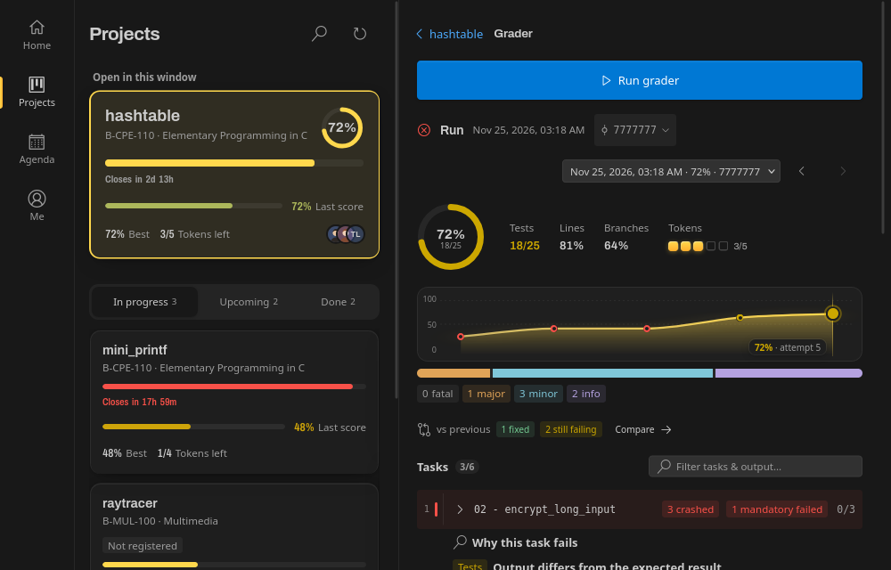
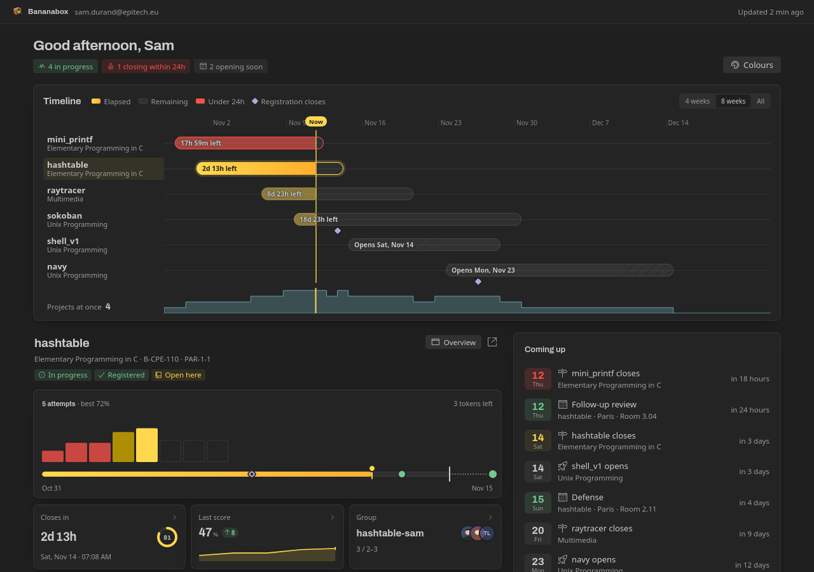
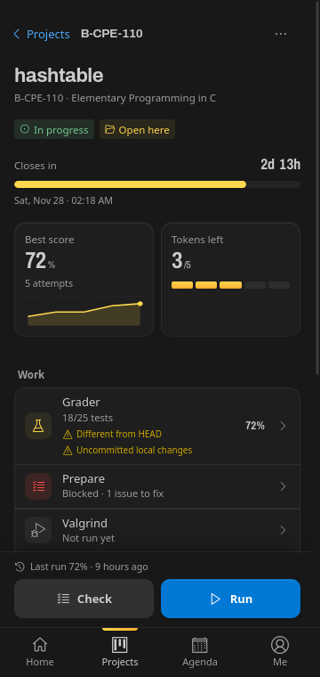
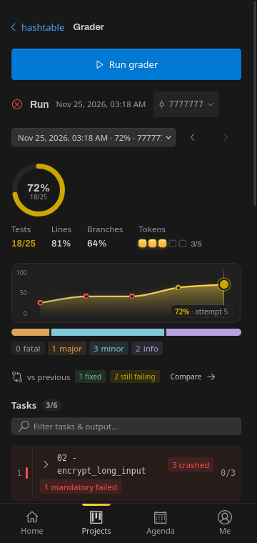
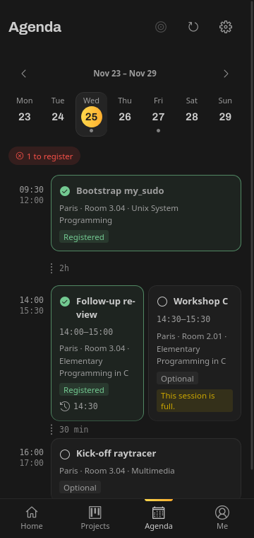

# Your whole Epitech semester, one click away

Stop juggling the intranet, the grader page and your terminal. Bananabox puts your projects, your grader results, your agenda and the coding style checker right inside VS Code, so you spend your time coding instead of tab-switching.

  

## Why students install it

**Never waste a grader token again.** Before you run, Bananabox checks your coding style, build, local tests, required files and the functions the subject allows. It also warns you when the commit that will be graded is not the one on your screen.

**Understand a failing task in seconds.** Every attempt is kept: your score over time, what broke, what got fixed since the last run, and the exact output that differs.

**Always know what is due.** Deadlines, time left, tokens left and your best score for every project, with the one you have open on top.

**Never miss a session.** Your week at a glance, free time and overlapping sessions shown as they really are, registration in one tap, and, if you turn it on in **Me**, a full-screen countdown before every defense.

**Clean code as you type.** epiclang findings appear in the editor while you write, with corrections you review before they apply.

  
  
  
  

## Get started in a minute

1. Click **Install**.
2. Open **Bananabox** in the activity bar and sign in with your Epitech Microsoft account.
3. Open your project folder. Bananabox recognises it and you are ready to go.

For the coding style checker, install [epiclang](https://github.com/techneoncode/bananabox-public/blob/main/docs/coding-style.md). It works without signing in.

## Built for students, respectful of your data

Bananabox keeps the bare minimum: the version, an anonymous id and, once you sign in, your first name, the initial of your last name, your promotion and your campus. Your code and your grades never leave your computer, nothing is sold, and you can have everything deleted. Read the [terms](https://github.com/techneoncode/bananabox-public/blob/main/docs/terms.md).

Available in English and French. Using CLion? The same Bananabox runs there too: get the plugin from the [latest release](https://github.com/techneoncode/bananabox-public/releases/latest).

---

[What's new](https://github.com/techneoncode/bananabox-public/blob/main/CHANGELOG.md) · [Source code](https://github.com/techneoncode/bananabox-public) · [Report an issue](https://github.com/techneoncode/bananabox-public/issues)

Bananabox is an independent student project, not affiliated with Epitech.
