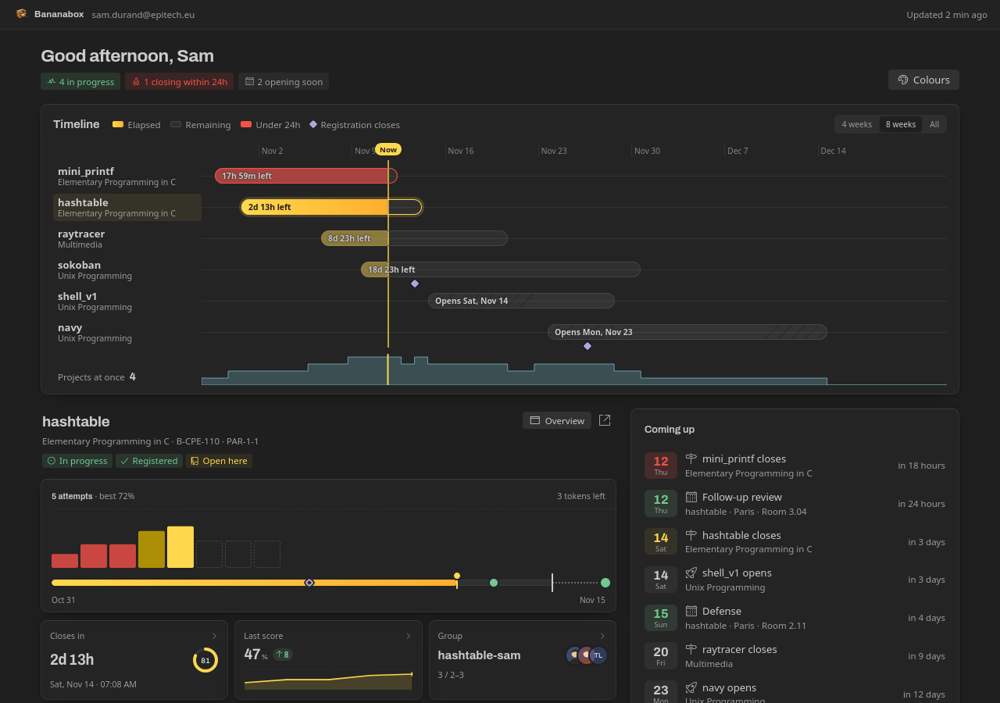
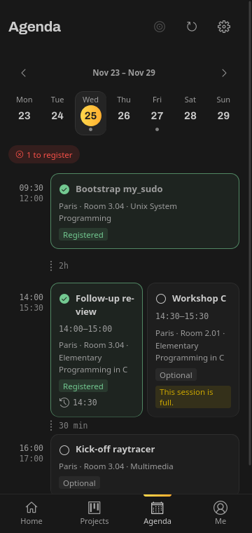

<p align="center">
  
</p>

<h1 align="center">Bananabox</h1>

<p align="center">
  <strong>Your Epitech projects, grader and coding style, right in your editor.</strong>
</p>

<p align="center">
  <a href="https://github.com/techneoncode/bananabox-public/releases/latest"></a>
  <a href="https://marketplace.visualstudio.com/items?itemName=techneoncode.bananabox"></a>
  <a href="clion/README.md"></a>
  <a href="LICENSE"></a>
</p>

<p align="center">
  <a href="https://marketplace.visualstudio.com/items?itemName=techneoncode.bananabox">Marketplace</a> ·
  <a href="#installation">Installation</a> ·
  <a href="#features">Features</a> ·
  <a href="#documentation">Documentation</a> ·
  <a href="CHANGELOG.md">Changelog</a>
</p>

<p align="center">
  
</p>

## Features

- **Projects at a glance.** Deadlines, scores and tokens left for every project, with the one open in your window on top.
- **Grader without the browser.** Run the grader, read each failing task, compare attempts and follow your score over time.
- **Checks before you spend a token.** Coding style, build, local tests, required files and allowed functions read from the subject.
- **Agenda.** Your week of sessions, free time and overlaps shown as they are, registration in one tap or automatically.
- **Coding style as you type.** epiclang findings in the editor, with corrections you review before they apply.
- **Defense reminders.** An optional full-screen countdown 60, 30 and 15 minutes before your slot. Off by default: turn it on in **Me**.

<p align="center">
  
  
  
  
</p>

## Installation

**VS Code** (1.95 or later): install it from the [VS Code Marketplace](https://marketplace.visualstudio.com/items?itemName=techneoncode.bananabox), search **Bananabox** in the Extensions view, or run

```sh
code --install-extension techneoncode.bananabox
```

**CLion** (2026.3, Node.js 20+): download `bananabox-clion-<version>.zip` from the [latest release](https://github.com/techneoncode/bananabox-public/releases/latest), then **Settings → Plugins → ⚙ → Install Plugin from Disk**. See the [CLion guide](clion/README.md) for what differs from VS Code.

## Quick start

1. Open **Bananabox** in the activity bar and sign in with your Epitech Microsoft account.
2. Open a project folder: Bananabox recognises it and puts it on top.
3. For coding style, install [epiclang](docs/coding-style.md). Coding style works without signing in, in trusted workspaces.

> **Note**
> The grader evaluates your latest **pushed** commit and costs a token. Bananabox warns you when it differs from your local `HEAD`.

## Documentation

| Guide | What it covers |
| --- | --- |
| [Coding style](docs/coding-style.md) | epiclang setup, settings, corrections |
| [Submission guide (FR)](docs/grader.fr.md) | Preparing and pushing a delivery |
| [CLion](clion/README.md) | Installing and using the CLion plugin |
| [Development](docs/development.md) | Building, testing and packaging |
| [Remote API](docs/remote-control.md) | The configuration and admin API |
| [Terms and data](docs/terms.md) | What is collected and why |

The interface is available in English and French (`bananabox.language`).

## License

[MIT](LICENSE). Bananabox is an independent project by [techneoncode](https://github.com/techneoncode), not affiliated with Epitech.
