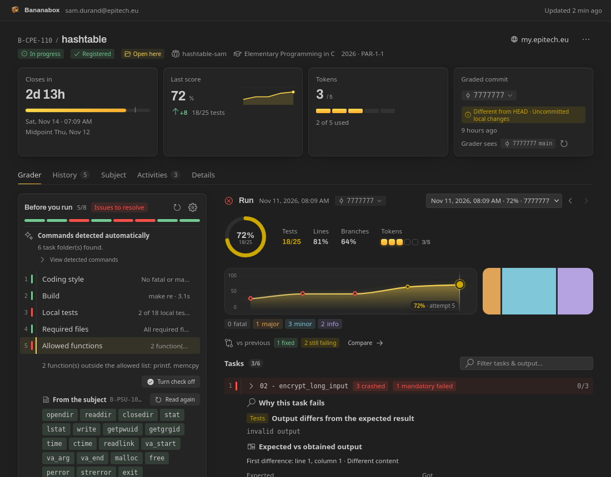
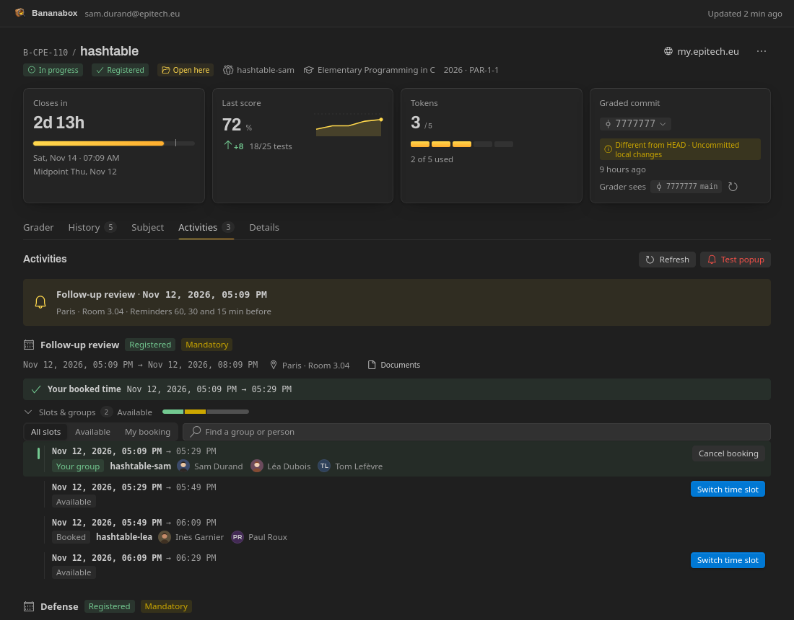
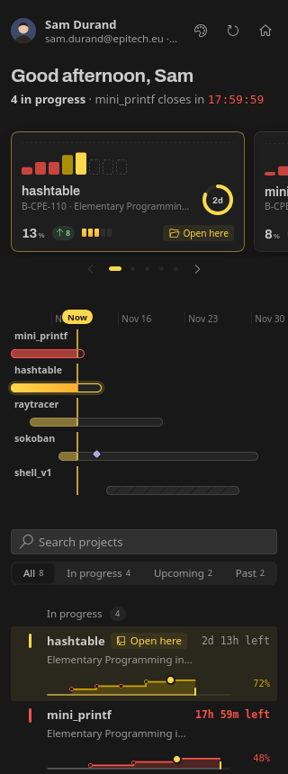

  

<h1 align="center">Bananabox</h1>

Your Epitech projects, grader and coding style, inside VS Code.

  

## What it does

| | |
|---|---|
| **Projects** | Deadlines, subjects, repositories. Bananabox detects the project you have open. |
| **Grader** | Tokens left, run the grader, read results, compare attempts, track your score. |
| **Before you run** | Checks coding style, build, local tests, required files and allowed functions before you spend a token. |
| **Activities** | Book, switch or cancel slots. See who is in which group. |
| **Calendar** | Required sessions by day or week. Optional automatic registration. |
| **Defense reminders** | A full-screen countdown 60, 30 and 15 minutes before your slot. |
| **Coding style** | epiclang findings as you type, with optional corrections you review first. |
| **Commit diffs** | Compare a graded commit with your current code. |

## Screenshots

  
   <em>Grader results, with the pre-run checklist. Allowed functions are read from the subject PDF.</em>

  
   <em>Book or switch a slot without leaving the editor.</em>

  
   <em>Coding style errors inline, coloured by severity.</em>

  
  &nbsp;&nbsp;
  
   <em>Sidebar and defense reminder.</em>

## Get started

1. Install Bananabox (VS Code **1.95+**).
2. Open **Bananabox** in the activity bar and sign in with your Epitech Microsoft account.
3. For coding style, install **epiclang**. If it isn't found, run **Bananabox Coding Style: Locate the epiclang executable**.

Coding style works without signing in, in trusted workspaces only.

## Good to know

- The grader evaluates your latest **pushed** commit and costs a token. Bananabox warns you when it differs from your local HEAD.
- Acknowledge a defense reminder with **Ctrl+Alt+Shift+Y** (**Cmd+Alt+Shift+Y** on macOS). Reminders only run while VS Code is open and you are signed in.
- Corrections are off by default. Old `bananalens.*` settings and `.bananalens.json` files still work. Disable the standalone Banana Lens extension to avoid duplicate findings.
- Interface in English or French (`epibox.language`). Search **Bananabox** in settings for everything else.

## Links

[Submission guide (FR)](docs/grader.fr.md) · [Coding style](docs/coding-style.md) · [Development](docs/development.md) · [Remote API](docs/remote-control.md) · [Terms and data collected](docs/terms.md) · [MIT license](LICENSE)

Made by [techneoncode](https://github.com/techneoncode). Independent project, not affiliated with Epitech.
